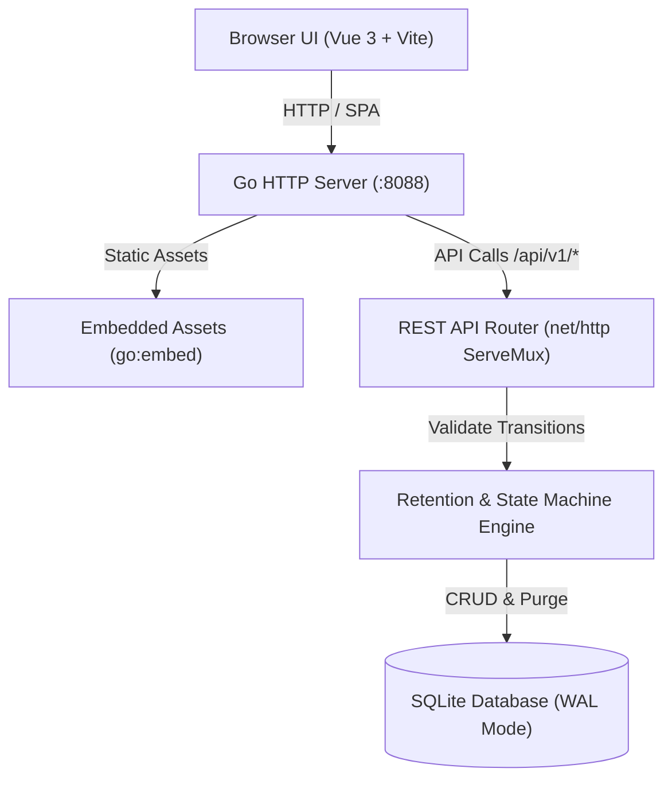

# ⚡ TaskMaster

> **Lightweight, local-first task and project management engine with embedded SQLite WAL and automated data retention.**

TaskMaster is an all-in-one productivity tracker designed for solo developers and teams who want complete data privacy without cloud dependencies. It compiles into a single, dependency-free binary containing both the Go backend and a sleek Vue 3 dark-neon dashboard.

---

## ✨ Features

- 🔒 **100% Local-First & Fast**: Zero external cloud accounts. All data resides in an embedded SQLite database using Write-Ahead Logging (WAL) for sub-millisecond query performance.
- 🎯 **Executive KPI Dashboard**: Real-time progress metrics (lifetime tasks done, pending queue, in-progress active count, average task age) filtered strictly to active projects.
- 🔥 **Priority Radar & Diagnostics**: Action radar highlighting urgent/overdue tasks and project health indicators (On Track, Lagging, Needs Attention).
- 📋 **Interactive Kanban Board**: HTML5 drag-and-drop task progression across configurable status columns (`Backlog`, `ToDo`, `In Progress`, `Done`, `Killed`).
- ☑️ **Task Checklists (Subtasks)**: Embedded to-do lists within tasks with live completion percentages directly visible on Kanban cards.
- 🧹 **Automated Retention Engine (TTL)**: Automatically purges completed/killed tasks older than your configured retention policy (e.g., 30 or 15 days) while **permanently preserving cumulative lifetime completion metrics** on each project.
- 📁 **Active & Archived Projects**: Clean separation of active workloads from archived projects, including dedicated Project Summary views and management modals.
- 🎨 **Dark Slate & Neon Theme**: Custom dark slate UI (`#0b0f19`) accented with glowing electric blue outlines (`#38bdf8`).
- 📦 **Single-Binary & Docker Ready**: The compiled Vue 3 SPA is embedded directly into the Go executable using `//go:embed`. Run anywhere as a single binary or in a lightweight (~25MB) Docker container.

---

## 🚀 Quickstart with Docker

### Option 1: Run with `docker run`

Run TaskMaster with persistent volume storage for your database:

```bash
docker run -d \
  --name taskmaster \
  -p 8088:8088 \
  -v taskmaster-data:/data \
  --restart unless-stopped \
  ghcr.io/dark13angel/taskmaster:latest
```

Open your browser and visit: **`http://localhost:8088`**

### Option 2: Run with Docker Compose

1. Clone or download the repository.
2. Launch with Docker Compose:

```bash
docker compose up -d
```

To stop the service:

```bash
docker compose down
```

---

## 🛠️ Running from Scratch (Local Development)

### Prerequisites

- **Go**: 1.22 or later ([Download Go](https://go.dev/dl/))
- **Node.js**: 18.x or later ([Download Node](https://nodejs.org/))
- **npm** (included with Node.js)

### Step 1: Clone the Repository

```bash
git clone https://github.com/<your-username>/TaskMaster.git
cd TaskMaster
```

### Step 2: Configure Environment

Copy the example `.env` file:

```bash
cp .env.example .env
```

Default configuration:
```env
PORT=8088
TASK_TTL_DAYS=30
CLEANUP_INTERVAL_HOURS=6
# Optional: custom data directory (defaults to ~/.taskmaster)
# TASKMASTER_DATA_DIR=/custom/path
```

### Step 3: Build & Run the Unified Application

You can build the frontend once and embed it directly into the Go binary:

```bash
# 1. Install frontend dependencies and build static assets
cd web
npm install
npm run build
cd ..

# 2. Compile and run the standalone Go binary
go run ./cmd/taskmaster
```

Visit **`http://localhost:8088`** to use TaskMaster!

---

### Step 4: Optional Frontend Development (Hot-Reloading)

If you are modifying the Vue components and want instant hot-reloading:

1. **Terminal 1 (Backend API)**:
   ```bash
   go run ./cmd/taskmaster
   ```
2. **Terminal 2 (Vite Dev Server)**:
   ```bash
   cd web
   npm run dev
   ```
   Open **`http://localhost:5173`** (Vite proxies all `/api` requests to `http://localhost:8088`).

---

## ⚙️ Configuration Reference

Settings can be specified in your `.env` file or passed as container environment variables:

| Variable | Default | Description |
| :--- | :--- | :--- |
| `PORT` | `8088` | HTTP port the TaskMaster server listens on. |
| `TASK_TTL_DAYS` | `30` | Retention period in days for completed/killed tasks before automated purging. |
| `CLEANUP_INTERVAL_HOURS` | `6` | Frequency in hours at which the background cleanup routine runs. |
| `TASKMASTER_DATA_DIR` | `~/.taskmaster` | Directory path where SQLite database (`taskmaster.db`) is stored. |

---

## 🏗️ Architecture & State Flow



### Automated Retention Logic
When tasks reach terminal status (`Done` or `Killed`) and exceed `TASK_TTL_DAYS`:
1. The cleanup engine calculates the number of `Done` tasks to be purged for each project.
2. It atomically increments `projects.historical_done_count += count(purged_done_tasks)`.
3. It deletes the expired tasks from the database.
4. **Result**: Your database stays lean and fast while your project lifetime completion statistics remain **100% accurate** indefinitely.

---

## 🔌 REST API Endpoints

All endpoints respond with `application/json` and standard HTTP status codes.

### Projects
| Method | Endpoint | Description |
| :--- | :--- | :--- |
| `GET` | `/api/v1/projects` | List all projects with metadata and lifetime done counts. |
| `POST` | `/api/v1/projects` | Create a new project. |
| `PATCH` | `/api/v1/projects/{id}` | Update name, description, or toggle `is_archived`. |
| `DELETE` | `/api/v1/projects/{id}` | Permanently delete project and associated tasks. |

### Tasks
| Method | Endpoint | Description |
| :--- | :--- | :--- |
| `GET` | `/api/v1/tasks` | List active project tasks (supports `?project_id=`, `?priority=`, `?search=`). Pass `?include_archived=true` for all. |
| `GET` | `/api/v1/tasks/{id}` | Get task details including subtask checklist. |
| `POST` | `/api/v1/tasks` | Create a new task. |
| `PATCH` | `/api/v1/tasks/{id}` | Update task title, notes, priority, or due date. |
| `POST` | `/api/v1/tasks/{id}/move` | Move task to a new status tag (validates state transitions). |
| `DELETE` | `/api/v1/tasks/{id}` | Delete a task. |

### Subtasks (Checklists)
| Method | Endpoint | Description |
| :--- | :--- | :--- |
| `GET` | `/api/v1/tasks/{id}/subtasks` | List checklist items for a task. |
| `POST` | `/api/v1/tasks/{id}/subtasks` | Add a new checklist item. |
| `PATCH` | `/api/v1/subtasks/{id}` | Toggle item completion status (`is_done`). |
| `DELETE` | `/api/v1/subtasks/{id}` | Delete a checklist item. |

### System & Maintenance
| Method | Endpoint | Description |
| :--- | :--- | :--- |
| `GET` | `/api/v1/health` | Healthcheck endpoint (`{"status": "ok"}`). |
| `POST` | `/api/v1/system/cleanup?days=30` | Trigger manual retention purge routine. |

---

## 🔄 CI/CD & Automated Releases

The included GitHub Actions workflow (`.github/workflows/release.yml`) automates deployment on every push to `main`:

1. **Tests & Validation**: Automatically tests Go packages and compiles the Vue 3 frontend.
2. **Git Tagging**: Automatically creates and pushes an incremental semantic tag (`v1.0.<run_number>`).
3. **Cross-Platform Binaries**: Compiles standalone binaries for macOS (Intel & Apple Silicon), Linux (AMD64 & ARM64), and Windows (AMD64).
4. **GitHub Release**: Publishes a new GitHub Release with release notes and downloadable binary archives.
5. **Multi-Arch Docker Images**: Builds and pushes multi-architecture images (`linux/amd64`, `linux/arm64`) to the GitHub Container Registry (`ghcr.io`):
   - `ghcr.io/dark13angel/taskmaster:latest`
   - `ghcr.io/dark13angel/taskmaster:v1.0.<run_number>`

---
